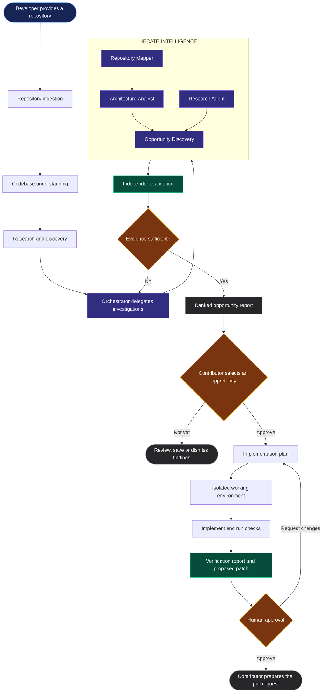
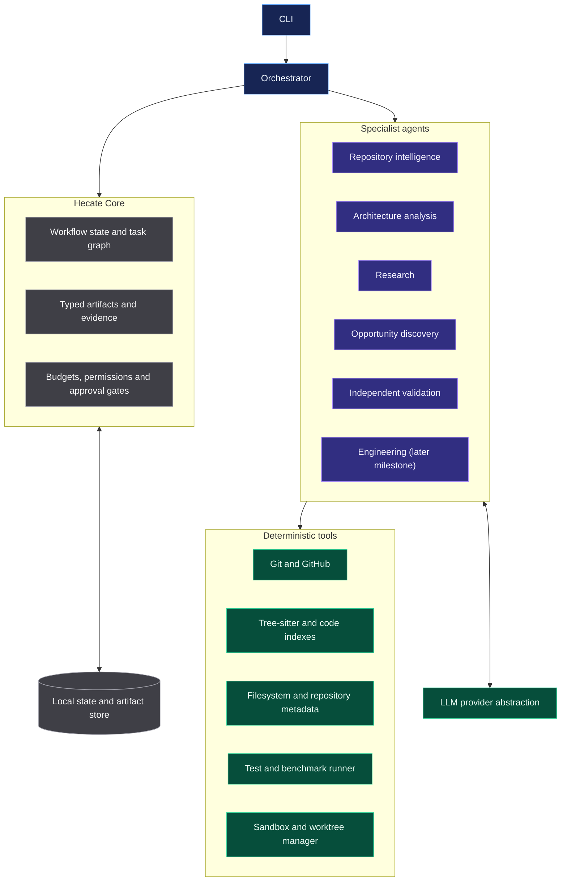

<div align="center">

# HECATE

### Navigate. Understand. Improve.

**An open-source repository intelligence tool for discovering meaningful software contributions.**

[](#project-status)
[](https://www.rust-lang.org/)
[](#the-current-cli)
[](#project-status)

*Every codebase is a labyrinth. Hecate helps you find the path to a worthwhile contribution.*

</div>

---

## The idea

Contributing to an unfamiliar open-source project takes more than finding an issue and asking an AI to write code. A contributor has to understand the architecture, trace behaviour across files, investigate existing discussions, identify a problem that actually matters, implement a suitable change, and prove that the change works.

That discovery process is often the hardest part.

**Hecate is being built to help contributors move from an unfamiliar repository to an evidence-backed contribution opportunity.**

Give Hecate a GitHub repository. It will aim to map the codebase, investigate its history and ecosystem, discover improvement opportunities, and help turn a selected opportunity into a tested change—with the contributor in control.

## How Hecate is envisioned to work



The diagram represents the **intended workflow**. HECATE supports local repository inspection, heuristic discovery from public GitHub issues, contribution planning, approved local workspace preparation, and a CLI flow for validating and applying user-supplied or model-generated structured patches after explicit human review. Repository test execution and independent validation remain future work.

## What Hecate aims to do

| Capability | Purpose |
|---|---|
| Repository reconnaissance | Inspect files, documentation, dependencies, metadata and history |
| Architectural understanding | Map modules, symbols, imports and important relationships |
| Contextual research | Examine issues, pull requests, discussions and relevant documentation |
| Opportunity discovery | Find potential bugs, performance bottlenecks, testing gaps and design improvements |
| Evidence-based ranking | Prioritise findings by impact, confidence, effort and risk |
| Assisted implementation | Plan and implement a contributor-selected change in isolation |
| Verification | Run relevant checks and report exactly what passed, failed, or remains unknown |
| Contribution preparation | Help the contributor prepare a clear, reviewable patch and pull request |

## Design principles

### 1. Understand before acting
Hecate should build a useful model of the repository before recommending changes. File names and isolated snippets are not enough.

### 2. Evidence before confidence
Every finding should point to supporting evidence: relevant code, tests, documentation, repository history or external references. A hypothesis must not be presented as a reproduced bug.

### 3. Independent validation
Discovery agents should not be the final judges of their own findings. Important opportunities should be challenged and checked independently.

### 4. Human authority
Hecate may investigate, plan, implement, and verify. The contributor decides what to pursue, reviews changes, and controls whether anything is submitted upstream.

### 5. Isolation by default
Contribution preparation uses a dedicated local clone and issue branch, separate from the contributor's existing checkout. Future implementation work must also use restricted execution environments. Untrusted repository code must never be treated as safe, merely because an AI agent selected it.

### 6. Useful over impressive
The goal is not to produce a long report or maximise the number of agents. The goal is to identify a small number of changes that genuinely help a project.

## The current CLI

Inspect a local repository or public GitHub repository:

```bash
hecate inspect ./path/to/repository
hecate inspect owner/repo
hecate inspect https://github.com/owner/repo
```

Discover contribution opportunities from a public repository's open issues:

```bash
hecate discover owner/repo
```

Discovery retrieves the default-branch source archive and paginated open issues, excludes pull requests, then applies the existing Rust analyzers and deterministic text matching to suggest possible files and symbols. Results include factor scores and matching evidence.

Select an issue number from the discovery results to investigate it and generate a reviewable contribution plan:

```bash
hecate plan owner/repo 123
hecate plan https://github.com/owner/repo 123
```

Planning retrieves the same cached repository snapshot and current open issues, then includes issue metadata, candidate code locations, module/import relationships, applicable heuristic test-gap signals, and relevant README/CONTRIBUTING/docs excerpts. It proposes implementation steps, test recommendations, validation commands, risks, assumptions, and unresolved questions. The command only reads and analyzes repository content; it does not implement the issue or modify the target repository. Review the plan and confirm issue scope before any future implementation.

After reviewing a plan, prepare an isolated local clone for that issue. HECATE retrieves/analyzes the repository first (which may populate its source cache), then shows the target and asks for explicit confirmation before creating the contribution workspace:

```bash
hecate prepare owner/repo 123
hecate prepare owner/repo 123 --workspace-dir ./hecate-workspaces
```

To apply a patch proposal you prepared yourself, use `contribute`:

```bash
hecate contribute owner/repo 123 --proposal ./proposal.json
hecate contribute owner/repo 123 --proposal ./proposal.json --workspace-dir ./hecate-workspaces
hecate contribute owner/repo 123 --generate
```

The two proposal inputs are exclusive. `--proposal` takes UTF-8 JSON `PatchProposal` schema version `1`, with exact `replace` operations (original SHA-256 and text edits) or `create` operations (new UTF-8 content). Input is capped at 8 MiB before parsing. `--generate` uses the configured OpenAI-compatible provider and HECATE's native runtime with only the six registered read-only repository tools; set `HECATE_API_KEY`, `HECATE_BASE_URL`, and `HECATE_MODEL`. The plan, tool definitions, and repository excerpts/results may be sent to that provider. Configure only a provider trusted with the repository data; workspace creation confirmation is not a separate provider disclosure consent prompt.

Both modes create a fresh issue workspace and retain its trusted capabilities in memory through validation, complete escaped preview, exact full-hash interactive approval, application, and outcome reporting. Workspace creation and patch application each require explicit interactive confirmation; there is no `--yes` or environment approval. Generated proposals are untrusted and must pass the same validator; no model response can approve or apply changes. HECATE does not run tests or other repository commands, commit, push, or create pull requests. Failed or rejected workflows preserve the prepared workspace. Multi-file changes are not atomic as a group; review recovery instructions and preserved artifacts if application reports recovery required.

By default, workspaces are stored in the platform user-data directory under `.hecate/workspaces`; `HECATE_WORKSPACE_DIR` or `--workspace-dir` can override the root. Each workspace contains a dedicated Git clone in `repository/`, a branch named `hecate/issue-<number>` at the exact commit used for planning, and versioned plan/audit metadata under `.hecate/`. Existing issue workspaces and matching remote branch names are never overwritten or reused. Preparation contacts GitHub to clone the public source and check for a branch-name collision. Git hooks and configured external checkout filters are disabled for the clone and branch checkout, and Git LFS smudging is skipped. HECATE does not push, create pull requests, edit source files, execute repository build/test scripts, or remove workspaces. If an operation fails after reserving the workspace directory, HECATE preserves it for inspection and reports its path.

All issue-to-code mappings and rankings are heuristic suggestions, not confirmed bugs or validated fixes. Current source analysis is Rust-focused. GitHub API rate limits apply to unauthenticated requests; set `GITHUB_TOKEN` or `GH_TOKEN` to use an optional token. The discovery and planning commands do not modify source code or create pull requests.

## Planned architecture

Hecate is intended to be a Rust-first application with a single CLI entry point and a modular internal architecture.



The architecture is a direction, not a locked implementation specification. A key distinction: deterministic operations—Git commands, parsing, file access and test execution—belong in tools. Agents reason over the results and produce structured findings. The orchestrator controls workflow, budgets and permissions.

## Engineering direction

The current direction is:

- **Rust** for the core application, CLI, orchestration and execution infrastructure.
- **Synchronous Rust CLI** in the current implementation; an async runtime has not been selected.
- **Tree-sitter** for language-aware source parsing.
- **Dedicated local clones** for approved workspace preparation; future execution isolation is not implemented.
- **SQLite** as a possible local persistence layer for early versions.
- **Serde** for typed, serialisable artifacts.
- **LLM provider abstraction** to avoid tying the project to one model vendor.
- **MCP support** as a possible additional interface after the core workflow is established.

SQLite and MCP remain possibilities, not current dependencies or implemented features. Hecate will avoid unnecessary microservices and dependencies.

## Documentation

The canonical implementation documentation is in [`docs/`](docs/):

- [Architecture and data flow](docs/ARCHITECTURE.md)
- [Native agent runtime](docs/AGENT_RUNTIME.md)
- [Security boundaries](docs/SECURITY.md)
- [Provider contract](docs/PROVIDERS.md)
- [Implementation status and roadmap](docs/ROADMAP.md)
- [Instructions for coding agents](AGENTS.md)

[`docs/MVP.md`](docs/MVP.md) is an earlier product specification. The canonical roadmap and current source describe implemented behavior.

## Roadmap

Repository inspection, GitHub contribution discovery, planning, approved workspace preparation, the native agent runtime, and both user-supplied and model-generated proposal modes in `contribute` are implemented. Generated changes still require deterministic validation and full-hash human approval. Independent review/verification (Milestone 5) remains future work. See the [detailed roadmap](docs/ROADMAP.md).

## Safety and trust

Repositories are untrusted input. Source files, documentation, build scripts and dependencies can contain malicious instructions or executable behaviour. The read-only tools below do not execute repository content. Any later execution capability must:

- Separate reading and static analysis from code execution.
- Run untrusted commands in disposable, restricted environments.
- Avoid exposing personal credentials, API keys or host secrets to repository code.
- Restrict network access and resource consumption during execution.
- Keep implementation attempts isolated from one another.
- Require explicit human approval before upstream submission.

The current native agent foundation includes six registered, read-only repository tools: `list_files`, `read_file`, `search_code`, `inspect_symbol`, `find_references`, and `read_diff`. They are bound to a prepared HECATE checkout, revalidate its workspace manifest and stored plan, and use a capability-scoped filesystem root. File access rejects absolute paths, traversal, symlinks and HECATE/Git metadata; scans and returned data have limits. Common credential filenames and recognizable secret lines are filtered or redacted.

The `contribute` CLI connects patch proposal validation, interactive approval, and controlled application. It accepts user-supplied schema-versioned JSON proposals up to 8 MiB or uses `--generate` to request an untrusted proposal from the configured native provider through six read-only repository tools. Both modes support only exact text replacements and new-file proposals, compute a deterministic SHA-256 hash, and display a complete review preview. Approval requires a real interactive terminal and the full patch hash. The command retains the prepared workspace capability in-process and consumes the private one-use approval through the application API. Application stages and verifies results before modifying targets, then verifies each result and attempts reverse-order rollback after failure. It does not run tests or other repository commands. Multi-file changes are not atomic as a group, and process or machine failure can leave partial changes. See [SECURITY.md](docs/SECURITY.md).

The model agent has a restricted repository-reading interface, not a complete security sandbox. Repositories remain untrusted; no shell, build, test, or other repository process is run by the agent tools or `contribute` workflow. Secret detection is heuristic and cannot guarantee that arbitrary credentials embedded in ordinary source files are recognized. Patch application is exposed only through `contribute` after interactive human approval; it is not registered as an agent tool. It uses capability-relative checks where available and per-file atomic operations, but does not provide group atomicity or crash-safe transactions.

Workspace preparation and Git operations still use path-based operations. Identity checks before and after these operations detect many workspace, checkout, or metadata substitutions, but cannot prevent every concurrent path replacement. A malicious concurrent process running as the same OS user with write access to the selected workspace parent is outside HECATE's current threat model. Capability-relative patch validation protects reads after its capabilities are established; it does not retroactively secure preparation. A prepared workspace is not an OS security sandbox. Windows path duplicate checks use ordinal case-insensitive comparison and do not prove equivalence under every volume's filesystem rules. See [SECURITY.md](docs/SECURITY.md) for the precise boundaries.

When `contribute --generate` uses the native runtime, conversation context, repository excerpts, and tool results are sent to the configured model provider. Configure only a provider trusted with that repository data. Exact configured-key redaction helps prevent accidental exposure but does not replace secret management or guarantee detection of every secret. There is no general-purpose agent command or separate provider consent workflow. Provider request-size limits are separate from HTTP timeouts; see the [provider guide](docs/PROVIDERS.md).

The runtime includes a real provider adapter and deterministic reliability/integration coverage. The `contribute --generate` workflow lets the model inspect through read-only tools and propose a patch, but HECATE validation and human approval are still mandatory before application. Independent review/verification is not implemented.

## Project status

**Hecate is in early implementation.** The CLI supports local inspection, public GitHub repository retrieval, Rust source analysis, open-issue retrieval, heuristic issue-to-code mapping and contribution ranking, evidence-backed draft plans, explicitly approved isolated local Git workspaces, and `contribute` flows for user-supplied or model-generated replacement/new-file proposals with full-hash approval. The model agent is limited to six read-only repository tools; patch application is restricted to validated human-approved operations. There is no general-purpose write tool, shell tool, or validation runner. Planning and reference matching remain heuristic; HECATE does not execute repository code or tests. The project license has not yet been selected.

This repository will evolve alongside the implementation. Design decisions, milestones and limitations should remain visible rather than being hidden behind ambitious claims.

## Contributing

Early feedback on the product direction, architecture, threat model, and discovery quality is welcome. Contribution guidelines will be added as the codebase takes shape.

## Name

In Greek mythology, Hecate is associated with crossroads, thresholds, torches and guidance through darkness.

The name reflects the project's purpose: helping developers navigate unfamiliar software and find a path toward meaningful work.

---

<div align="center">

**HECATE**

*Find the path. Prove the change.*

</div>
