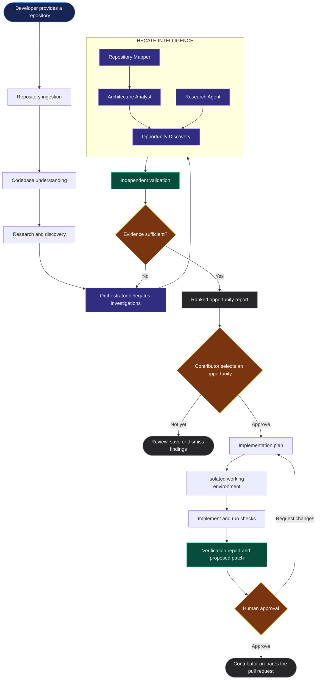
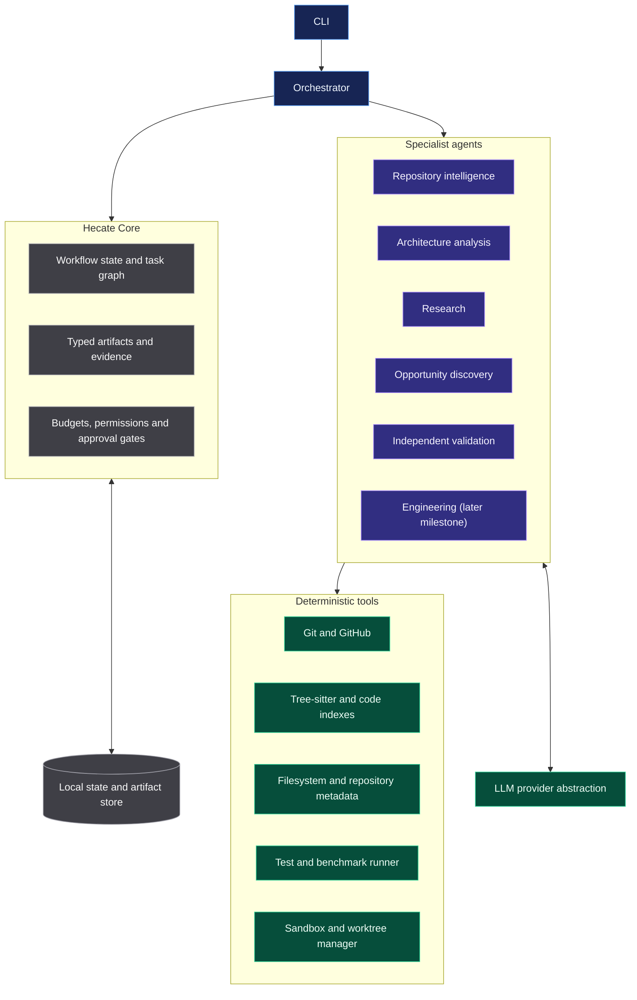

<div align="center">

# HECATE

### Navigate. Understand. Improve.

**An open-source, AI-powered repository intelligence system for discovering and delivering meaningful software contributions.**

[](#project-status)
[](https://www.rust-lang.org/)
[](#the-planned-cli)
[](#project-status)

*Every codebase is a labyrinth. Hecate helps you find the path to a worthwhile contribution.*

</div>

---

## The idea

Contributing to an unfamiliar open-source project takes more than finding an issue and asking an AI to write code. A contributor has to understand the architecture, trace behaviour across files, investigate existing discussions, identify a problem that actually matters, implement a suitable change, and prove that the change works.

That discovery process is often the hardest part.

**Hecate is being designed to help contributors move from an unfamiliar repository to an evidence-backed, verified contribution.**

Give Hecate a GitHub repository. It will aim to map the codebase, investigate its history and ecosystem, discover improvement opportunities, and help turn a selected opportunity into a tested change—with the contributor in control.

## How Hecate is envisioned to work



The diagram represents the **intended workflow** , not implemented functionality. The first milestone focuses on repository understanding and trustworthy opportunity discovery. Implementation and contribution assistance follow once the analysis is reliable.

## What Hecate aims to do

| Capability | Purpose |
|---|---|
| Repository reconnaissance | Inspect files, documentation, dependencies, metadata and history |
| Architectural understanding | Map modules, symbols, imports and important relationships |
| Contextual research | Examine issues, pull requests, discussions and relevant documentation |
| Opportunity discovery | Find potential bugs, performance bottlenecks, testing gaps and design improvements |
| Evidence-based ranking | Prioritise findings by impact, confidence, effort and risk |
| Assisted implementation | Plan and implement a contributor-selected change in isolation |
| Verification | Run relevant checks and report exactly what passed, failed or remains unknown |
| Contribution preparation | Help the contributor prepare a clear, reviewable patch and pull request |

## Design principles

### 1. Understand before acting
Hecate should build a useful model of the repository before recommending changes. File names and isolated snippets are not enough.

### 2. Evidence before confidence
Every finding should point to supporting evidence: relevant code, tests, documentation, repository history or external references. A hypothesis must not be presented as a reproduced bug.

### 3. Independent validation
Discovery agents should not be the final judges of their own findings. Important opportunities should be challenged and checked independently.

### 4. Human authority
Hecate may investigate, plan, implement and verify. The contributor decides what to pursue, reviews changes, and controls whether anything is submitted upstream.

### 5. Isolation by default
Future implementation work should happen in isolated worktrees and restricted execution environments. Untrusted repository code must never be treated as safe merely because an AI agent selected it.

### 6. Useful over impressive
The goal is not to produce a long report or maximise the number of agents. The goal is to identify a small number of changes that genuinely help a project.

## The first milestone

The initial version will be deliberately narrow.

```bash
hecate inspect owner/repo
```

The first milestone aims to produce:

- A concise repository overview.
- A map of important modules and relationships.
- A summary of relevant project conventions and dependencies.
- A shortlist of evidence-backed improvement opportunities.
- Impact, confidence, effort and risk assessments for each finding.
- Source locations and supporting evidence so a contributor can investigate further.

**Initial success criterion:** Hecate produces findings that a developer can independently inspect and judge useful—not merely plausible AI-generated suggestions.

Automatic code modification is intentionally outside the first milestone.

## Planned architecture

Hecate is intended to be a Rust-first application with a single CLI entry point and a modular internal architecture.



The architecture is a direction, not a locked implementation specification. A key distinction: deterministic operations—Git commands, parsing, file access and test execution—belong in tools. Agents reason over the results and produce structured findings. The orchestrator controls workflow, budgets and permissions.

## Engineering direction

The current direction is:

- **Rust** for the core application, CLI, orchestration and execution infrastructure.
- **Tokio** for asynchronous tasks and concurrency.
- **Tree-sitter** for language-aware source parsing.
- **Git worktrees** for isolated implementation attempts.
- **SQLite** as a possible local persistence layer for early versions.
- **Serde** for typed, serialisable artifacts.
- **LLM provider abstraction** to avoid tying the project to one model vendor.
- **MCP support** as a possible additional interface after the core workflow is established.

Technology choices will be validated during architecture design. Hecate will avoid unnecessary microservices and avoid adding dependencies just because they are fashionable.

## Roadmap

The roadmap is ordered around proving reliability before increasing autonomy.

- [ ] **Phase 0 — Product and architecture**
  - [ ] Define requirements, scope and success criteria
  - [ ] Finalise the system architecture and agent contracts
  - [ ] Establish threat model and execution boundaries
- [ ] **Phase 1 — Repository reconnaissance**
  - [ ] Rust workspace and CLI foundation
  - [ ] GitHub repository retrieval and local checkout
  - [ ] File, language and dependency inventory
  - [ ] Initial repository map and report
- [ ] **Phase 2 — Repository intelligence**
  - [ ] Symbol and module extraction
  - [ ] Import and dependency relationships
  - [ ] Architecture summary with source references
- [ ] **Phase 3 — Opportunity discovery**
  - [ ] Research issues, pull requests and documentation
  - [ ] Generate evidence-backed improvement candidates
  - [ ] Rank candidates and independently validate findings
- [ ] **Phase 4 — Assisted engineering**
  - [ ] Contributor-approved implementation plans
  - [ ] Isolated worktree and sandbox execution
  - [ ] Test, benchmark and verification reports
- [ ] **Phase 5 — Contribution workflow**
  - [ ] Reviewable patch generation
  - [ ] Pull request preparation
  - [ ] Human-controlled submission

## Safety and trust

Repositories are untrusted input. Source files, documentation, build scripts and dependencies can contain malicious instructions or executable behaviour.

The planned execution model will therefore aim to:

- Separate reading and static analysis from code execution.
- Run untrusted commands in disposable, restricted environments.
- Avoid exposing personal credentials, API keys or host secrets to repository code.
- Restrict network access and resource consumption during execution.
- Keep implementation attempts isolated from one another.
- Require explicit human approval before upstream submission.

These safeguards are design requirements; they are not yet implemented.

## Project status

**Hecate is in the planning and architecture stage.** The vision, initial audience and product direction have been established. The CLI, agents, analysis pipeline and execution environment are planned work—not currently available features. The project license has not yet been selected.

This repository will evolve alongside the implementation. Design decisions, milestones and limitations should remain visible rather than being hidden behind ambitious claims.

## Contributing

The project is not yet ready for external implementation contributions. Early feedback on the product direction, architecture, threat model and roadmap is welcome. Contribution guidelines will be added as the codebase takes shape.

## Name

In Greek mythology, Hecate is associated with crossroads, thresholds, torches and guidance through darkness.

The name reflects the project's purpose: helping developers navigate unfamiliar software and find a path toward meaningful work.

---

<div align="center">

**HECATE**

*Find the path. Prove the change.*

</div>
