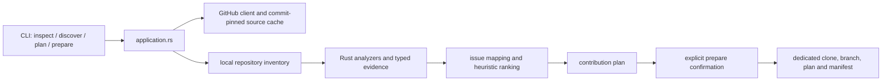

# HECATE architecture

HECATE is a modular Rust CLI application. Deterministic repository access and analysis produce typed evidence; discovery and planning use that evidence to create heuristic recommendations. A separate native agent runtime can call explicitly registered tools, but it is not yet wired to a CLI command or a live model provider.

## Components

| Component | Responsibility |
|---|---|
| `src/main.rs` | Clap command parsing, workflow selection, terminal prompts, and report rendering. |
| `src/application.rs` | Orchestrates inspection, analysis, discovery, and issue planning. |
| `src/inspection/` | Inventories a local repository's top-level entries, project markers, source files, and language counts. |
| `src/analysis/` | Deterministic analyzers: Rust module indexing, dependency graph construction, tree-sitter symbols/imports, import resolution, architecture map, heuristic test gaps, and evidence-backed findings. |
| `src/github.rs` | Parses public GitHub targets; retrieves repository metadata, commit, source archives, and paginated open issues; filters pull requests; caches commit-pinned archives. |
| `src/discovery.rs` | Maps issue text to candidate files/symbols using deterministic text and repository relationships, then calculates an explainable heuristic ranking. |
| `src/planning.rs` | Builds a structured, reviewable plan using issue metadata, discovery matches, repository relationships, test-gap signals, and relevant Markdown excerpts. |
| `src/workspace.rs` | Requires approval to create a dedicated clone/issue branch, stores versioned plan and manifest metadata, and revalidates prepared workspaces. |
| `src/agent/` | Provider-independent request/response types, mock provider, runtime loop, session state, tool definitions/registry/policies, and prepared-workspace readers. |

The current analysis is Rust-focused. Repository inventory recognizes several language extensions, but module, import, symbol, dependency, architecture, findings, and test-gap analysis is implemented around Rust. Other languages can be inventoried and searched as text by repository tools.

The current finding builder reports unresolved or ambiguous Rust imports, unresolved module declarations, and Rust parse errors. These findings are marked `NeedsValidation`; it is not a general bug detector. Test-gap analysis looks for a subset of direct Rust test calls and likewise does not establish that coverage is absent.

## CLI data flow

`inspect` accepts a local directory or GitHub repository. `discover` obtains open issues and ranks possible code matches. `plan` investigates one issue and prints a draft plan. `prepare` obtains the current issue/plan, previews the workspace and asks before creating the local clone and branch. None of these commands implements an issue or runs repository build/test code.

GitHub requests use the blocking `reqwest` client and optional `GITHUB_TOKEN`/`GH_TOKEN`. Source archives are cached by repository and commit; issue data is fetched from the API when requested. Source extraction has archive and expanded-size bounds and skips archive links.

## Native agent data flow

The agent subsystem is currently a library-like internal module in the binary, not a user-facing agent workflow:

1. An `AgentSession` is initialized with repository/issue context, a plan reference marked approved, and initial messages.
2. `AgentRuntime` sends typed messages and the tool registry's definitions to a `ModelProvider`.
3. The provider returns text or typed tool-call requests and optional token usage.
4. The runtime preflights calls (IDs, registered names, permission policy, and tool-specific arguments) before dispatch.
5. The registry dispatches only to an explicitly registered `Tool`; result/error records are added to the session.
6. The loop ends in a terminal state or reaches iteration/tool-call limits.

The only provider implementation is `MockProvider`. The six registered repository tools are read-only and validate the workspace manifest and stored plan before access. See [AGENT_RUNTIME.md](AGENT_RUNTIME.md), [PROVIDERS.md](PROVIDERS.md), and [SECURITY.md](SECURITY.md).

## Current boundaries

- No live model API provider, agent CLI command, MCP support, or persistent session store.
- No file-writing/patch tool, arbitrary command tool, repository-code execution, or validation runner.
- Discovery and test-gap results are heuristic leads, not confirmation of a defect or absent coverage.
- A Git clone is workspace isolation from the user's original checkout, not an operating-system security sandbox.

The current implementation status and proposed work are tracked in [ROADMAP.md](ROADMAP.md). The source code is authoritative when documentation and implementation disagree.
